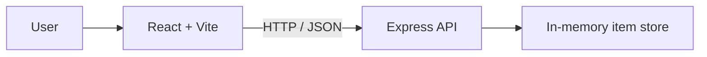

# Octofit Tracker

<div align="center">
  

  **A beginner-friendly, full-stack fitness tracking exercise built with GitHub Copilot agent mode.**

  [](LICENSE)
  [](https://nodejs.org/)
  [](https://react.dev/)
  [](https://www.typescriptlang.org/)
  [](https://expressjs.com/)

  [](https://github.com/riazaslam029/skills-build-applications-w-copilot-agent-mode/stargazers)
  [](https://github.com/riazaslam029/skills-build-applications-w-copilot-agent-mode/issues)
  [](https://github.com/riazaslam029/skills-build-applications-w-copilot-agent-mode/forks)
</div>

---

## About the Project

**Octofit Tracker** is a workshop application for learning how to build, extend, and reason across a modern multi-tier codebase with **GitHub Copilot agent mode**. The current prototype provides a React interface for creating and viewing items, backed by a TypeScript Express API.

The repository also explores the product story behind Octofit Tracker: a fitness experience designed to help students log activities, build positive habits, and participate in friendly competition.

## Key Features

- **Create items** through a responsive React interface
- **View and refresh** items from the backend
- **REST API** with health, list, and create endpoints
- **In-memory storage** for simple local development
- **Full-stack TypeScript** across the frontend and backend
- **Codespaces-ready** development environment
- **Copilot-focused learning** for agent-assisted development

## Preview

<div align="center">
  
</div>

## Architecture



| Layer | Technology | Responsibility |
|:--|:--|:--|
| Frontend | React 19, Vite 7 | User interface and API interactions |
| Backend | Express 4, TypeScript | REST endpoints and request handling |
| Data | In-memory store | Fast, local-only item persistence |
| Environment | GitHub Codespaces | Reproducible development setup |

## Getting Started

### Prerequisites

- [Node.js 20 or later](https://nodejs.org/)
- npm
- Git
- [GitHub Copilot](https://github.com/features/copilot) (for the workshop workflow)

### GitHub Codespaces

Open this repository in Codespaces for a ready-to-use development environment:

1. Select **Code** at the top of this repository.
2. Open the **Codespaces** tab.
3. Create a new codespace on the `main` branch.

### Local Setup

Clone the repository and install dependencies:

```bash
git clone https://github.com/riazaslam029/skills-build-applications-w-copilot-agent-mode.git
cd skills-build-applications-w-copilot-agent-mode

npm --prefix octofit-tracker/backend install
npm --prefix octofit-tracker/frontend install
```

### Run the Application

Start both frontend and backend services from the repository root:

```bash
npm run dev
```

This starts:

- Frontend: <http://localhost:5173>
- Backend: <http://localhost:8000>

To run the services separately:

```bash
npm --prefix octofit-tracker/backend run dev
npm --prefix octofit-tracker/frontend run dev
```

> Items are held in memory and reset whenever the backend restarts.

## API Reference

| Method | Endpoint | Description |
|:--|:--|:--|
| `GET` | `/health` | Check backend availability |
| `GET` | `/api/items` | Retrieve all items |
| `POST` | `/api/items` | Create a new item |

Example request:

```bash
curl -X POST http://localhost:8000/api/items \
  -H "Content-Type: application/json" \
  -d '{"name":"Morning workout"}'
```

## Configuration

| Variable | Service | Default | Purpose |
|:--|:--|:--|:--|
| `PORT` | Backend | `8000` | Backend listening port |
| `CORS_ORIGIN` | Backend | `http://localhost:5173` | Allowed frontend origin |
| `VITE_API_URL` | Frontend | `http://localhost:8000` | Backend API base URL |

## Project Structure

```text
.
├── .devcontainer/                 # GitHub Codespaces configuration
├── docs/
│   ├── octofit_story.md           # Project concept and workshop story
│   └── octofitapp-small.png       # Octofit Tracker artwork
├── octofit-tracker/
│   ├── backend/
│   │   └── src/
│   │       ├── routes/            # REST route handlers
│   │       ├── store/             # In-memory data store
│   │       ├── server.ts          # Express application
│   │       └── types.ts           # Shared backend types
│   └── frontend/
│       ├── src/
│       │   ├── services/          # API client
│       │   ├── App.tsx            # Main React component
│       │   └── index.css          # Application styles
│       └── vite.config.ts
├── scripts/dev.mjs                # Starts frontend and backend together
├── LICENSE
└── README.md
```

## Workshop Guide

Read [Octofit Tracker Project Story](docs/octofit_story.md) for the complete exercise context, learning goals, application concept, and recommended Copilot workflow.

Useful GitHub resources:

- [Getting started with GitHub Copilot Chat](https://docs.github.com/en/copilot/how-tos/use-chat/get-started-with-chat)
- [Build applications with GitHub Copilot agent mode](https://github.com/features/copilot)
- [Prompt engineering for GitHub Copilot](https://docs.github.com/en/copilot/concepts/prompt-engineering)

## Development

Build the backend and frontend:

```bash
npm --prefix octofit-tracker/backend run build
npm --prefix octofit-tracker/frontend run build
```

## Contributing

Contributions that improve documentation, accessibility, tests, or the sample application are welcome.

1. Fork the repository.
2. Create a focused branch: `git checkout -b feature/your-feature`
3. Make your changes and test them locally.
4. Commit your work with a clear message.
5. Open a pull request describing the change and why it is needed.

Please keep contributions beginner-friendly and avoid committing local environment files or generated dependencies.

## License

This project is licensed under the **MIT License**. See [LICENSE](LICENSE) for the full text.

---

<div align="center">

**Octofit Tracker** • Built for learning with GitHub Copilot

</div>
